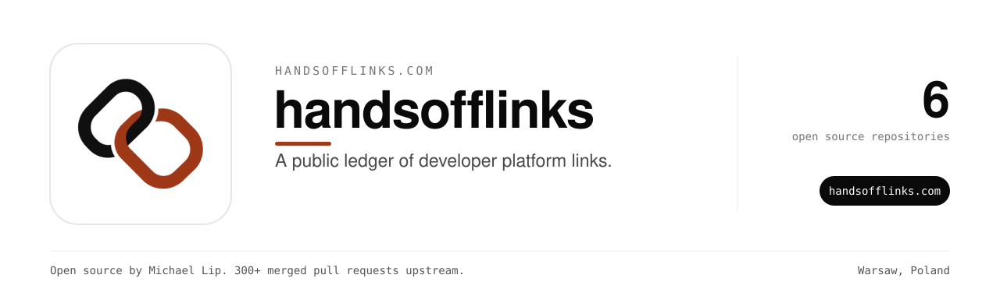

A free public ledger of links built through developer platforms, with audit results.

Use it at [handsofflinks.com](https://handsofflinks.com).

### Repositories

| Repository | What it does |
| --- | --- |
| [followability-rs](https://github.com/handsofflinks/followability-rs) | Parse rel token lists, robots meta and X-Robots-Tag into one link-followability verdict. |
| [followcheck](https://github.com/handsofflinks/followcheck) | Decide whether an outbound link on a page is really followable and really crawlable. Zero dependencies. |
| [link-followability](https://github.com/handsofflinks/link-followability) | Crystal shard: classify links by rel tokens (nofollow/ugc/sponsored), meta robots and X-Robots-Tag |
| [link-followability-php](https://github.com/handsofflinks/link-followability-php) | PHP library that resolves whether a link on a served page is followed: rel token lists, robots meta tags and X-Robots-Tag headers combined into one verdict, with the reason that decided it. |
| [linkfollow-d](https://github.com/handsofflinks/linkfollow-d) | D library that resolves whether a link on a served page is followed: rel link types, meta robots and X-Robots-Tag precedence, plus a start-tag attribute reader. |

### Sponsor this work

Everything here is free to use. Sponsoring Michael on GitHub pays for the servers, the AI API bills and the hours behind each fix across 12 organizations and 1,800+ public repositories. It starts at $3 a month.

### More open source from the same maintainer

<table><tr><td align="center" width="9%"><a href="https://github.com/zovo-one"> Zovo</a></td><td align="center" width="9%"><a href="https://github.com/notemods"> NoteMods</a></td><td align="center" width="9%"><a href="https://github.com/ml0x-com"> ml0x</a></td><td align="center" width="9%"><a href="https://github.com/toolsthatrank"> ToolsThatRank</a></td><td align="center" width="9%"><a href="https://github.com/BeLikeNative"> BeLikeNative</a></td><td align="center" width="9%"><a href="https://github.com/ingredientcalculator"> Ingredient Calculator</a></td><td align="center" width="9%"><a href="https://github.com/lakelevelnow"> LakeLevelNow</a></td><td align="center" width="9%"><a href="https://github.com/seeninaianswers"> Seen in AI Answers</a></td><td align="center" width="9%"><a href="https://github.com/makeroll"> MakeRoll</a></td><td align="center" width="9%"><a href="https://github.com/aiwebsitepipeline"> AI Website Pipeline</a></td><td align="center" width="9%"><a href="https://github.com/worthmyclaim"> WorthMyClaim</a></td></tr></table>

### Maintainer

Built and maintained by [Michael Lip](https://github.com/theluckystrike) in Warsaw, Poland.
He also fixes bugs in projects he uses. He has 300+ merged pull requests in 200+ outside repositories, including [urllib3](https://github.com/urllib3/urllib3/pull/5330), [Appium](https://github.com/appium/appium/pull/22911), [Prefect](https://github.com/PrefectHQ/prefect/pull/21916) and [Google Chrome extension samples](https://github.com/GoogleChrome/chrome-extensions-samples/pull/1629).
Need an engineer for your own product or AI agent? Send a written brief at [axdale.com](https://www.axdale.com/?utm_source=github&utm_medium=org&utm_campaign=hire&utm_content=handsofflinks).
